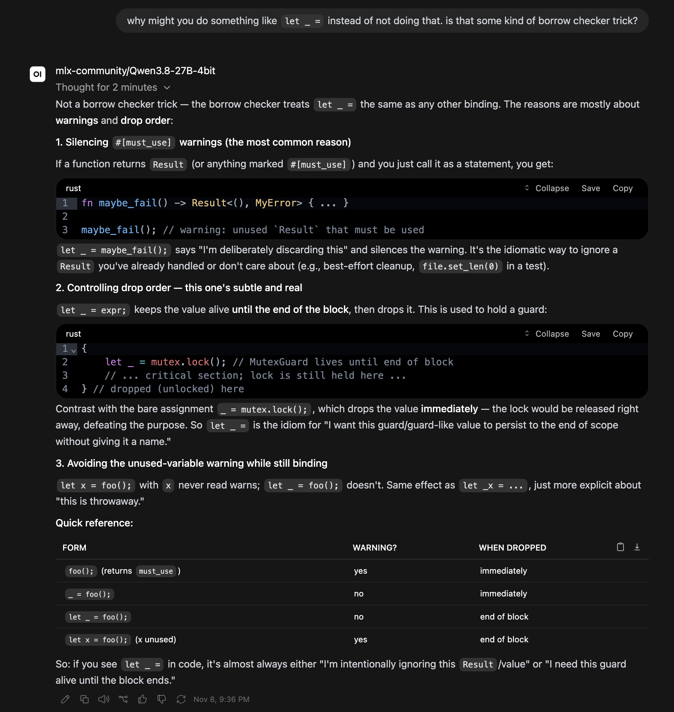

# Temporary Agent Setup Notes

> Last updated: November 2026



Not a robust solution; a series of commands that gets an agent running locally
that's mostly functional. Instructions not guaranteed to work exactly as
written. You need at least 32GB of free RAM to run them.

```sh
cd .temp-setup
brew bundle

# start model
mlx_lm.server --model mlx-community/Qwen3.8-27B-4bit

# configure search
mkdir -p `~/.search`
cp settings.yml ~/.search/settings.yml

# start search service
podman machine start
podman run -d --name searxng -p 8081:8080 -v "~/.search:/etc/searxng" searxng/searxng

# generate terminal service password
openssl rand -base64 32

# start terminal service
pipx install open-terminal
open-terminal run --host 127.0.0.1 --port 8082 --api-key "[[TERMINAL PASSWORD]]"
```

Finally open Open WebUI and load the [config.json](./config.json),
[SYSTEM.md](./SYSTEM.md) into it.

## Setup-specific Issues

- Policy guidelines take 10-15m to establish.
- Qwen gets caught in loops even with the repeat penalties turned all the way
  up. You have to stop and restart the response manually when this happens.
